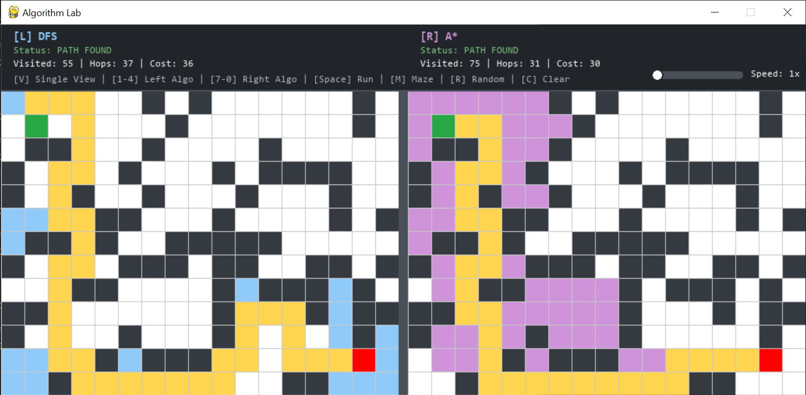

# Algorithm Lab

An interactive path-finding visualizer and maze editor built in Python with Pygame.



---

## Why I Made This

Pathfinding algorithms like BFS, DFS, Dijkstra, and A* are fundamental computer science concepts, but understanding how they behave in practice—especially with obstacles, bottlenecks, and variable movement costs—can be difficult from static pseudocode alone.

I created **Algorithm Lab** to build a visual, hands-on sandbox where anyone can:
- Observe how algorithms explore graph search frontiers step-by-step in real time.
- Directly compare unweighted shortest-path exploration against heuristic-directed search and cost-aware graph traversals.
- Paint dynamic terrain weights (like mud) and generate procedural labyrinths with one keypress to see how algorithms react to challenging environments.

---

## Features 

- ## Interactive Maze Editor: Click and drag on an editable grid to draw obstacles, clear walls, and reposition start or destination points. 
- ## Architecture:
    - `grid.py`: Python Grid data model and coordination validation
    - `algorithms.py`: graph search algorithms 
    - `main.py`: grid mapping, mouse and key events, and rendering algorithms
    - `maze-generators.py`: 
- ## Key Features
- **Single & Dual-View Modes**: Switch dynamically between a focused single-grid view and a side-by-side synchronized canvas to race two algorithms head-to-head on the identical board.
- **Dynamic Terrain & Weights**: Paint weighted mud tiles (movement cost = 5) to observe how heuristic-driven and cost-aware algorithms detour around expensive ground while unweighted algorithms plow straight through.
- **Procedural Maze Generation**: Generate winding labyrinth corridors with Recursive Backtracking or scatter rock-like obstacles across the map with one keypress.
- **Step-by-Step Traversal Animation**: Generator-driven exploration reveals frontier expansion and visited nodes tick-by-tick before animating the reconstructed path.
- **Real-Time Telemetry HUD**: Monitors active algorithms, status, node exploration counts, path hop lengths, and total weighted costs directly on the canvas.
- **Dynamic Speed Control**: Adjust the simulation playback rate (1x to 15x) on the fly without interrupting running searches.
___

## Project Structure

```text
algorithm-lab/
├── grid.py          
├── algorithms.py    
├── main.py         
├── maze-generators.py
└── README.md

```
___

## How to Run

### Prerequisites
- Python 3.8+ installed

### Installation and Lunch
1. Clone Repository
```bash
git clone https://github.com/TRI-DevLab/algorithm-lab.git

```

2. Install Pygame
```bash
pip install pygame

```

3. Run Visualizer
```bash
python main.py

```

___

## Controls 

### View & Simulation controls 
| Action | Input | Description |
| :--- | :---: | :--- |
| **Toggle Dual View** | <kbd>V</kbd> | Toggle between Single View and Side-by-Side Dual View |
| **Run / Race** | <kbd>Space</kbd> | Start path-finding simulation or side-by-side race |
| **Clear Board** | <kbd>C</kbd> | Clear all walls, mud, and visual paths |
| **Adjust Speed** | `Click / Drag` | Drag the slider on the top HUD to adjust speed (1x–15x)|

#### Maze Generation
| Action | Input | Description |
| :--- | :---: | :--- |
| **Recursive Maze** | <kbd>M</kbd> | Carve a winding labyrinth with guaranteed corridors |
| **Random Scatter** | <kbd>R</kbd> | Scatter independent wall obstacles across the board |

### Cell Editing
| Action | Input | Description |
| :--- | :---: | :--- |
| **Draw Wall** | `Left-Click` + Drag | Place impassable walls[cite: 1, 2] |
| **Paint Mud (Cost 5)** | <kbd>W</kbd> + `Left-Click` | Paint weighted mud cells |
| **Erase** | `Right-Click` + Drag | Erase walls or mud back to normal ground[cite: 2] |
| **Move Start Node** | <kbd>S</kbd> + `Left-Click` | Reposition the Start node (Green) |
| **Move Goal Node** | <kbd>G</kbd> + `Left-Click` | Reposition the Goal node (Red) |

### Algorithm Selection
| Mode | Controls | Available Algorithms |
| :--- | :---: | :--- |
| **Single-View Mode** | <kbd>1</kbd> – <kbd>4</kbd> | `[1]` BFS &nbsp; `[2]` DFS &nbsp; `[3]` A* &nbsp; `[4]` Dijkstra |
| **Dual-View: Left Canvas** | <kbd>1</kbd> – <kbd>4</kbd> | `[1]` BFS &nbsp; `[2]` DFS &nbsp; `[3]` A* &nbsp; `[4]` Dijkstra |
| **Dual-View: Right Canvas** | <kbd>7</kbd>, <kbd>8</kbd>, <kbd>9</kbd>, <kbd>0</kbd> | `[7]` BFS &nbsp; `[8]` DFS &nbsp; `[9]` A* &nbsp; `[0]` Dijkstra |